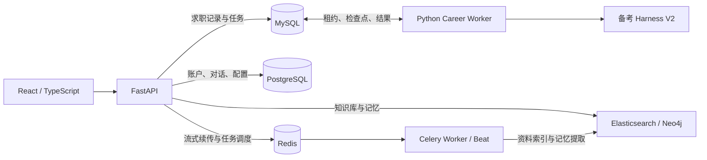

# Search Agent · 研究生求职与面试训练工作台

Search Agent 面向实习和校招。选定一个目标岗位后，可以用 JD、已确认的经历和练习记录制定备考计划，完成刷题与模拟面试，再整理岗位简历、网申材料和投递回执。

[功能概览](#功能概览) · [本地启动](#本地启动) · [系统架构](#系统架构) · [部署与验证](#部署与验证) · [文档索引](#文档索引)

## 功能概览

| 场景 | 从哪里开始 | 支持的操作 |
| --- | --- | --- |
| 定位目标岗位 | 岗位与公司、求职助手 | 保存 JD、技能要求和招聘来源。按岗位调研公司与面经，在对话中查看进度或创建备考任务。 |
| 制定备考计划 | 备考中心 | 指定题量、截止日期、复习顺序和是否排除已做题，结合岗位要求、个人资料及练习记录生成计划。支持查阅来源和对照历史版本。 |
| 刷题与复盘 | 备考中心、题库 | 按岗位、主题或题型组题，支持客观题判分、开放题点评、错题复做和练习续做。编程与 SQL 题可接 Judge0 兼容执行器。 |
| 模拟面试 | 模拟面试 | 进行文字或语音面试，查看逐题点评、动态追问和后续复习建议。视频模式提供本地摄像头自览。 |
| 简历与申请 | 网申助手、投递看板 | 用已确认的经历制作岗位简历，通过浏览器打印 PDF，准备网申草稿并追踪申请阶段。Greenhouse 扩展可辅助填表和读取回执，实际提交由用户确认。 |
| 管理资料与进度 | 个人工作区、计划与提醒 | 上传 PDF、Word、Markdown 等资料，用知识库问答回查引用。查看任务状态、Token 和执行记录，设置复习、面试及投递提醒。 |

「设置」提供模型、角色、Skill、MCP 工具和消息推送配置。技能中心支持使用内置求职模板，或通过 ZIP 与公开 GitHub 仓库的固定提交导入 Skill，并管理版本与回退。头像菜单中的「Comet 工作台」保留研究报告、定时任务、记忆图谱、角色群聊和每日回顾等能力。

## 本地启动

以下命令使用 PowerShell。准备 Docker 与 Docker Compose、Python 3.12 与 uv，以及 Node.js 22 与 npm。浏览器扩展可使用 Chrome 或 Edge。

```powershell
git clone https://github.com/JonyChuang/Search_Agent.git
Set-Location Search_Agent
```

### 1. 配置并启动存储

在仓库根目录准备两份配置，已有配置可继续使用。

```powershell
if (!(Test-Path .env)) { Copy-Item .env.example .env }
if (!(Test-Path api/.env)) { Copy-Item api/.env.example api/.env }
Push-Location api
uv sync --locked --python 3.12
Pop-Location
```

| 配置文件 | 本地启动需要填写的值 |
| --- | --- |
| 根目录 `.env` | 设置 `CAREER_MYSQL_PASSWORD`，由 Compose 和本地 Python 后端共用。已有 MySQL 数据卷时沿用数据库账户密码。 |
| `api/.env` | 将 `CAREER_MYSQL_HOST`、`CAREER_MYSQL_PORT` 分别设为 `127.0.0.1`、`3307`，并设置 `CAREER_NATIVE_WORKER_ENABLED=true`。 |
| `api/.env` | 使用随机 `JWT_SECRET`，默认 HS256 至少需要 32 字节。填写有效的 `FERNET_KEY`，已有数据时沿用原密钥。 |

在 `api/` 运行 `uv run --locked python -c "from cryptography.fernet import Fernet; print(Fernet.generate_key().decode())"` 可生成 Fernet 密钥。如果修改了根目录 `.env` 的 PostgreSQL 或 Neo4j 登录配置，同步修改 `api/.env`。

回到仓库根目录启动存储服务。

```powershell
docker compose up -d --build --wait postgres elasticsearch neo4j redis
docker compose -f compose.career.yml up -d --wait mysql
```

### 2. 启动后端和前端

终端一从仓库根目录启动 FastAPI。开发模式下，FastAPI 会同时启动 Career Worker。

```powershell
Set-Location api
uv run --locked alembic upgrade head
uv run --locked python -m scripts.migrate_career_mysql
uv run --locked uvicorn app.main:app --host 127.0.0.1 --port 8000
```

终端二从仓库根目录启动 Web 工作台。

```powershell
Set-Location web
npm ci
npm run dev
```

文档索引、后台记忆与研究任务需要 Celery Worker。定时任务和每日回顾还需要 Beat。按需从 `api/` 在各自的终端运行对应命令。

```powershell
uv run --locked celery -A app.celery_app.celery_app worker -l info -Q default,parse,memory,beat,research --pool=threads --concurrency=4
uv run --locked celery -A app.celery_app.celery_app beat -l info
```

### 3. 跑通第一个备考任务

1. 打开工作台，注册或登录。在「设置 → 模型配置」添加支持工具调用的默认对话模型。使用知识库索引和检索时，再配置输出维度与 `EMBEDDING_DIMS` 一致的 Embedding 模型。[本地工作台](http://localhost:5173)
2. 在「岗位与公司」录入 JD，打开「备考中心」生成计划。如果题库缺少岗位所需技能的题目，先补充本岗位的模拟题。
3. 到「任务中心」查看计划执行步骤。在「备考中心」完成练习并查看复盘。环境连通性可通过健康接口检查。[求职数据库](http://localhost:5173/api/career/health) · [后端存储](http://localhost:5173/api/health)

## 系统架构



- **备考 Harness V2** 在入队时冻结任务契约和候选题库。确定性校验覆盖题量、日期、技能、复习顺序和题目版本，通过后才保存。固定截止日期沿用确认时的时区和日期。[Harness 技术报告](docs/career-training-harness-v2.md) · [正确性与策略验收](docs/career-training-harness-v2-correctness.md)
- **可恢复任务** 通过 MySQL 租约、执行代次和检查点保护回写。Worker 接管后继续使用同一份契约和剩余预算，模型预约、临时重试和有效修复独立计量。默认使用 Learning V1，可按需启用带时效和置信度的学习策略。[运行架构与配置](docs/python-runtime-operations.md)
- **对话与资料** 使用 Redis Streams 续传事件，知识库以父子分块、BM25 和向量召回检索资料，支持可选 Rerank。页面与 Agent 共用业务权限，岗位与用户范围由服务端校验。

## 部署与验证

### 容器部署

部署前在根目录 `.env` 设置 `JWT_SECRET`、`FERNET_KEY`、`CAREER_MYSQL_PASSWORD`，按部署域名修改 `web/nginx.conf` 并把 TLS 证书放入 `web/certs/`。升级既有实例时先备份业务库并保留数据卷。生产环境由独立的 `career-worker` 消费求职任务，API 启动时应用 MySQL 迁移并核对已有校验和。[升级与生产验收](docs/python-runtime-operations.md)

```powershell
docker compose -f docker-compose.yml -f docker-compose.prod.yml up -d --build --wait
```

### 评测与验证

| 验证范围 | 已记录结果 |
| --- | --- |
| 备考工作流 · 19 个模型替身场景 | V1 完成 11/19，修复后的 V2 完成 17/19。V2 保存的 17 份计划均通过硬约束校验。 |
| 故障恢复 · 5 个同预算场景 | 修复后从 3/5 提高到 4/5，连续超时和限流的场景最终完成。 |
| 选题策略 · 10 个固定证据集 | 效用策略将相关新题从 28/42 提高到 41/42，岗位技能覆盖为 30/30，指定题保留为 10/10。 |
| MySQL 队列 · 隔离实例 | 16 次提交去重为 8 个任务，12 个并发认领请求首轮放行 4 个。验证了旧执行者回写拒绝和检查点恢复。 |

备考与选题结果来自本地模型替身及确定性选题对照。真实模型表现、供应商 Token 与真实作答效果待测。[验收报告与指标口径](docs/career-training-harness-v2-correctness.md#评测结果) · [RAG、上下文和历史调度评测](docs/career-agent-evaluation.md)

在 `api/` 运行后端检查。队列负载评测使用隔离的本机 MySQL。

```powershell
uv run --locked ruff check app
uv run --locked python -m unittest discover -s tests
uv run --locked python -m eval.harness_v2_eval --groups CD --extended --details
uv run --locked python -m eval.harness_retry_eval
uv run --locked python -m eval.career_training_harness_eval --policies
uv run --locked python -m eval.career_worker_load
```

在 `web/` 运行 `npx tsc --noEmit` 和 `npm run build` 检查前端。

## 文档索引

| 想查看 | 入口 |
| --- | --- |
| 运行架构、升级、回滚和队列运维 | [Python 运行手册](docs/python-runtime-operations.md) |
| 备考契约、验证器、修复与策略评测 | [Harness V2 正确性与策略验收](docs/career-training-harness-v2-correctness.md) |
| Greenhouse 扩展与 Skill 包 | [Greenhouse 操作说明](docs/career-agent-release.md#greenhouse-网申) · [Skill 包格式](docs/career-agent-release.md#skill-包格式) |
| 岗位、资料、题库和历史评测 | [完整文档目录](docs/README.md) |

按目录浏览 [FastAPI 与 Worker](api/) · [评测脚本与数据](api/eval/) · [React 前端](web/) · [判题与浏览器扩展](tools/) · [MySQL 迁移与历史 Java 代码](backend/)

Search Agent 基于 Comet 源码演进。[上游 Comet](https://github.com/lm041520/Comet)
