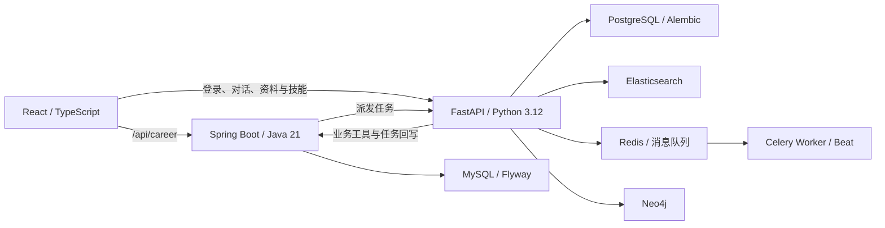

# Search Agent · 求职与面试训练工作台

Search Agent 是面向研究生实习与校招的求职工作台。它以目标岗位 JD 为主线，把个人资料、训练计划、刷题、模拟面试、简历定制和投递进展连在一起。

## 目录

- [核心功能](#核心功能)
- [技术栈](#技术栈)
- [系统架构](#系统架构)
- [环境要求](#环境要求)
- [本地启动](#本地启动)
- [首次使用](#首次使用)
- [容器部署](#容器部署)
- [评测与验证](#评测与验证)
- [目录结构](#目录结构)

## 核心功能

### 求职与面试

| 功能与入口 | 能做什么 | 实现方式 |
| --- | --- | --- |
| **求职总览与求职助手** | 选择当前岗位，查看备考或投递进度。可在对话中创建备考计划、文字模拟面试、简历草稿或网申草稿。 | React 工作台、FastAPI SSE 流式对话、岗位范围内的工具调用、Spring Boot 业务接口。 |
| **岗位与公司** | 管理目标岗位、JD、技能要求、招聘来源和备考偏好，开展公司调研并查看本岗位任务。 | Spring Boot + MySQL 保存岗位及来源。Python Agent 按公司与岗位组织联网检索，保留面经来源及时间。 |
| **备考计划** | 根据 JD、确认经历、选定资料和既有练习生成计划，复盘后可生成新版本并回看上一版。 | LangChain Function Calling 完成候选题查询和计划生成。Java 校验题目版本，MySQL 保存任务、结果与检查点。 |
| **面经、题库与组题练习** | 浏览公开面经与私有学习笔记，按岗位、主题或题型组题，支持 AI 出题、客观题判分、开放题点评、错题复做和练习续做。 | Java 服务端判分，MySQL 持久化作答及题目、评分规则版本。Python 根据选定资料出题。公开内容经审核后发布。 |
| **编程与 SQL 判题** | 提交代码或 SQL，查看状态与通过用例数。 | Java 调用 Judge0 兼容接口，可接独立 Judge0 CE 或本地禁网 Docker 执行器。本地 SQL 用临时 SQLite 数据库检查查询结果。 |
| **多轮模拟面试** | 按岗位进行文字或语音面试，也可开启本地摄像头自览。支持动态追问、未完成续做、逐题复盘与后续复习建议。 | Java 事务保存作答和点评任务，后台推进轮次。Python 按评分规则生成反馈。浏览器提供摄像头自览、语音合成及浏览器或已配置服务的语音转写。 |
| **简历制作** | 编辑个人资料和经历、切换模板，保存通用或岗位简历版本，通过浏览器打印为 PDF。 | React 模板与打印样式，Java/MySQL 保存资料版本和已确认经历的事实快照。 |
| **网申助手与投递看板** | 准备表单及材料，记录投递阶段和回执。Greenhouse 扩展辅助填写姓名、联系方式和简历，提交由用户核对并确认。 | Java 校验材料版本并保存投递历史，Chrome/Edge Manifest V3 扩展在获授权的招聘页面填表和读取回执。 |
| **计划与提醒** | 关联岗位设置复习、面试和投递截止提醒，可按已配置渠道发送站外通知。 | MySQL 存储提醒和送达状态，Spring 定时调度，Python 负责通知投递。 |

### 资料、记忆与 Agent 工作区

| 功能与入口 | 能做什么 | 实现方式 |
| --- | --- | --- |
| **我的资料与知识库问答** | 按库管理 PDF、Word、Markdown、文本、HTML、网页及图片，在问答中回查来源。备考时可选个人资料并查看原文引用。 | Celery 异步解析与索引。Elasticsearch 使用父子分块、IK 分词、向量 kNN 与 BM25 融合，支持可选 Rerank。岗位备考从选定文件提取相关段落并校验原文版本。 |
| **图文、语音与角色群聊** | 携带图片和文档提问，输入语音，或让同一角色组的角色参与对话。也可查看上传图片的描述和标签。 | 多模态模型理解图片，浏览器或已配置的 ASR 服务转写语音，Python 调度角色发言并以 SSE 返回内容。 |
| **求职记忆与知识图谱** | 管理确认经历和岗位备考偏好，查看历史作答及面试复盘。对话记忆支持图谱浏览、检索和纠正。 | Java/MySQL 管理岗位级记忆与事实版本，Python 按 Token 预算装配带原消息 ID 的历史约束。记忆抽取、关系与来源使用 Celery、Embedding 和 Neo4j。 |
| **全局搜索与收藏** | 按文档、图片和记忆查找资料，收藏常用内容。 | Elasticsearch 检索文档与图片描述，Neo4j 检索记忆，PostgreSQL 保存收藏记录。 |
| **任务中心** | 查看备考任务进度、执行步骤、耗时和 Token，暂停、继续或取消任务。 | MySQL 任务队列、执行租约、阶段检查点与任务事件。Redis 租约限制同会话对话并发。 |
| **研究、定时任务与分享** | 对一个主题收集资料并生成带引用的报告，配置定时执行和通知，查看运行历史。支持对话及研究报告分享、报告导出 Word。 | Python 分阶段编排检索、提炼和写作，可配置审稿模型。Celery Beat 与 Redis 调度，PostgreSQL 保存报告与分享记录，python-docx 生成 Word 文件。 |
| **运行追踪** | 查看对话、研究和定时任务的工具调用、模型用量、耗时及错误。 | Python 记录 Trace 与 Span，前端展示步骤时间线和模型成本估算。 |
| **每日回顾与音乐** | 在个人工作区查看近期对话回顾，管理音乐库并播放推荐歌曲。 | Celery Beat 生成回顾，Python 结合情绪和音乐偏好提供推荐，React 提供播放器。 |

### 配置与扩展

| 功能与入口 | 能做什么 | 实现方式 |
| --- | --- | --- |
| **模型配置** | 配置对话、多模态、Embedding、Rerank、联网搜索、ASR 或审稿模型。 | FastAPI 模型配置与客户端工厂，LangChain 与 HTTPX 调用模型，Fernet 加密保存模型密钥。 |
| **角色与工具配置** | 管理角色卡和角色组，配置知识库、记忆、联网等工具及 MCP 连接。 | LangChain 工具注册与编排，普通对话支持 Function Calling 和 ReAct 两种执行路径，MCP 通过 LangChain 适配器连接。 |
| **技能中心** | 使用求职模板，支持 ZIP 或公开 GitHub 仓库固定提交导入，并管理版本、更新、回退与卸载。 | 以 `manifest.yaml` 与 `SKILL.md` 描述技能。FastAPI 校验包结构和声明的只读工具，PostgreSQL 保存版本，Python 按任务加载已启用的技能。 |
| **消息推送** | 配置 Server 酱、企业微信、钉钉或通用 Webhook，用于任务结果和求职提醒。 | Python 通知适配器调用已启用的渠道，Java 或 Celery 按任务类型触发。 |

[功能入口、判题执行器、Greenhouse 扩展与 Skill 包格式](docs/career-agent-release.md)

## 技术栈

| 层级 | 组件与用途 |
| --- | --- |
| Web 前端 | React 18、TypeScript、Vite 6、React Router、Ant Design 5。Zustand 管理客户端状态，Axios 调用 API，ECharts 和 AntV X6 用于统计和图谱。 |
| Java 业务后端 | Java 21、Spring Boot 3.5.16、Spring Security OAuth2 Resource Server、Spring MVC、MyBatis-Plus、JdbcClient。MySQL 8.4 与 Flyway 负责业务持久化和迁移，Maven Wrapper 负责构建。 |
| Python Agent 服务 | Python 3.12、FastAPI、Uvicorn、Pydantic、LangChain、HTTPX、tiktoken，使用 uv 锁定依赖。处理对话、工具编排、任务推理、上下文预算和技能加载。 |
| 账号、配置与对话数据 | PostgreSQL 16、SQLAlchemy 2.0 Async、asyncpg、Alembic。存储账号、模型配置、对话、文档元数据及技能版本。 |
| 知识库检索与文件 | Elasticsearch 8.17 + IK、Embedding、可选 Rerank。PyMuPDF、python-docx、Beautiful Soup 和 Trafilatura 负责文本或网页提取，原文件可保存在本地或 OSS。 |
| 记忆与异步任务 | Neo4j 5.26 用于图谱记忆。Redis 7 支持对话租约、流式事件和 Celery 队列，Celery Worker 与 Beat 执行资料处理和定时任务。 |
| 安全与服务联通 | JWT 登录与验签，Fernet 加密模型密钥，Java 与 Python 通过 HTTP 及内部令牌交换任务，业务接口按账号校验数据归属。 |
| 扩展与部署 | Judge0 兼容判题服务、SQLite、Chrome/Edge Manifest V3 扩展。Docker Compose 启动存储与容器服务，Nginx 提供静态站点和反向代理。 |

## 系统架构



- **Java 业务服务**负责鉴权、岗位和材料、任务调度及业务状态。MySQL 短事务原子认领任务，通过租约、执行代次和幂等键处理过期回写与重复请求。
- **Python Agent**负责模型调用、Function Calling、上下文预算、Skill 加载和资料检索。训练任务持久化题目目录与计划草稿，可从检查点恢复。知识库使用父子分块、向量与 BM25 混合召回，并支持可选重排。
- **React 前端**提供求职工作台、流式对话、文档预览和任务状态。页面与 Agent 共用 Java 业务接口及权限规则。

## 环境要求

| 环境 | 用途 |
| --- | --- |
| Docker 与 Docker Compose | 运行 MySQL、PostgreSQL、Elasticsearch、Neo4j 和 Redis。容器部署也使用 Compose。 |
| JDK 21 | 运行 Spring Boot。开发时将 `JAVA_HOME` 指向 JDK，Maven 由项目内 Wrapper 提供。 |
| Python 3.12 与 uv | 安装并运行 FastAPI、Agent 和 Celery。 |
| Node.js 22 及 npm | 运行 Vite 开发服务器和构建 React 前端。 |
| Chrome 或 Edge | 需要使用 Greenhouse 扩展或语音、摄像头功能时，浏览器需支持对应能力并允许访问设备。 |

## 本地启动

以下命令以 PowerShell 为例。首次使用时先克隆仓库。

```powershell
git clone https://github.com/JonyChuang/Search_Agent.git
Set-Location Search_Agent
```

### 1. 配置并启动存储

从仓库根目录创建本地配置。已有配置可继续使用。

```powershell
if (!(Test-Path .env)) { Copy-Item .env.example .env }
if (!(Test-Path api/.env)) { Copy-Item api/.env.example api/.env }
```

| 配置 | 设置位置 |
| --- | --- |
| `JWT_SECRET` | `api/.env` 与 Java 启动终端使用相同的随机值，默认 HS256 要求至少 32 字节。 |
| `JWT_ALGORITHM` | 默认 `HS256`。若修改，Python 与 Java 启动环境使用相同算法。 |
| `CAREER_AGENT_INTERNAL_TOKEN` | `api/.env` 与 Java 启动终端使用同一个随机令牌。 |
| `CAREER_MYSQL_PASSWORD` | 根目录 `.env` 和 Java 启动终端使用相同的 MySQL 密码。若使用已有数据卷，沿用该卷初始化时的密码。 |
| `FERNET_KEY` | 填入 `api/.env`。安装 Python 依赖后，可在 `api/` 运行 `uv run --locked python -c "from cryptography.fernet import Fernet; print(Fernet.generate_key().decode())"` 生成。使用已有 PostgreSQL 数据时沿用原密钥。 |

如果改了根目录 `.env` 中的 PostgreSQL 或 Neo4j 登录配置，也要同步 `api/.env`。

```powershell
docker compose up -d --build --wait postgres elasticsearch neo4j redis
docker compose -f compose.career.yml up -d --wait
```

### 2. 启动 Python Agent

在单独的终端从仓库根目录执行。安装依赖后确认 `api/.env` 已配置有效的 Fernet 密钥。

```powershell
Set-Location api
uv sync --locked --python 3.12
uv run --locked alembic upgrade head
uv run --locked uvicorn app.main:app --host 127.0.0.1 --port 8000
```

文档上传后的索引构建需要 Celery Worker。在另一个终端进入 `api/` 后运行。

```powershell
uv run --locked celery -A app.celery_app.celery_app worker -l info -Q default,parse,memory,beat,research --pool=threads --concurrency=4
```

需要定时运行研究任务或生成定期回顾时，在独立终端进入 `api/` 启动 Beat。

```powershell
uv run --locked celery -A app.celery_app.celery_app beat -l info
```

### 3. 启动 Java 后端

从仓库根目录另开终端启动 Java。Flyway 会在启动时迁移 MySQL。

```powershell
$env:JWT_SECRET = Read-Host 'api/.env 中的 JWT_SECRET' -MaskInput
$env:CAREER_AGENT_INTERNAL_TOKEN = Read-Host 'api/.env 中的内部令牌' -MaskInput
$env:CAREER_MYSQL_PASSWORD = Read-Host '本地 MySQL career 用户密码' -MaskInput
Set-Location backend
.\mvnw.cmd spring-boot:run
```

### 4. 启动前端

从仓库根目录另开终端启动前端。

```powershell
Set-Location web
npm ci
npm run dev
```

打开 [本地工作台](http://localhost:5173)，注册或登录后进入「设置 → 模型配置」。配置支持工具调用的默认对话模型。需要知识库索引和检索时，再配置输出维度与 `EMBEDDING_DIMS` 一致的 Embedding 模型。

| 检查 | 地址 |
| --- | --- |
| Java 与 Agent 联通 | [`/api/career/health`](http://localhost:5173/api/career/health) |
| Python 存储连接 | [`/api/health`](http://localhost:5173/api/health) |

## 首次使用

1. 在「岗位与公司」录入一个目标岗位，保留 JD、技能要求和招聘来源。
2. 在「我的资料」上传备考笔记或面经。可选择资料进入备考，也可等待索引就绪后在「求职助手」开启知识库检索。
3. 在「备考中心」生成计划，选择题目练习后查看复盘。编程与 SQL 练习需要先配置判题执行器。
4. 在「模拟面试」选择同一岗位，完成作答和点评。语音模式可按浏览器权限启用。
5. 在「网申助手」编辑并保存岗位简历版本，准备申请材料。在「投递看板」记录提交与后续进展，也可按需配置 Greenhouse 扩展。

[可选功能的配置与使用步骤](docs/career-agent-release.md)

## 容器部署

根目录 `.env` 需要配置 `JWT_SECRET`、`FERNET_KEY`、`CAREER_MYSQL_PASSWORD` 和 `CAREER_AGENT_INTERNAL_TOKEN`。在 `web/nginx.conf` 设置部署域名与证书文件名，并将证书放入 `web/certs/`。

```powershell
docker compose -f docker-compose.yml -f docker-compose.prod.yml up -d --build --wait
```

## 评测与验证

| 评测 | 实测结果 |
| --- | --- |
| RAG 检索 | 在 48 篇中文技术短文档、40 条标注查询上，混合检索 Recall@5 为 **90.00%**，较 BM25 提高 **5.00 个百分点**。Hit@5 为 **92.50%**，MRR@5 为 **0.8562**。评测使用本地 BGE-small-zh-v1.5 向量，关闭 Rerank。 |
| 岗位上下文 | 在 72 条合成对话、144 条约束标注上，约束召回率从固定 40 条消息基线的 **83.33%** 提升至 **98.61%**，平均历史片段 Token 减少 **50.89%**。 |
| Java 任务调度 | 隔离 MySQL 上的 36 组并发负载中，540 个任务无重复认领，540 次重复请求均返回原任务。24 次租约到期接管全部成功，并拒绝了旧执行者的回写。 |
| 训练断点恢复 | 两处故障注入中，题目目录保存后恢复需 **1 次**模型调用，计划草稿保存后恢复需 **0 次**，最终各保留 **1 份计划**。 |

[数据集、指标口径与复跑命令](docs/career-agent-evaluation.md) · [训练恢复实测](docs/career-agent-training-checkpoints.md)

开发验证包括 `api/` 下的 `uv run --locked ruff check .`、`backend/` 下使用独立 MySQL 测试库运行的 `.\mvnw.cmd verify`，以及 `web/` 下的 `npx tsc --noEmit` 与 `npm run build`。

## 目录结构

| 路径 | 内容 |
| --- | --- |
| [backend/](backend/) | Spring Boot 业务服务、Flyway 迁移和集成测试 |
| [api/](api/) | FastAPI、Agent、知识库、Celery 和 Alembic 迁移 |
| [api/eval/](api/eval/) | 标注测试集与评测脚本 |
| [web/](web/) | React 求职工作台 |
| [tools/](tools/) | 判题执行器与 Greenhouse 浏览器扩展 |
| [docs/](docs/) | 架构、功能指南与评测记录 |
