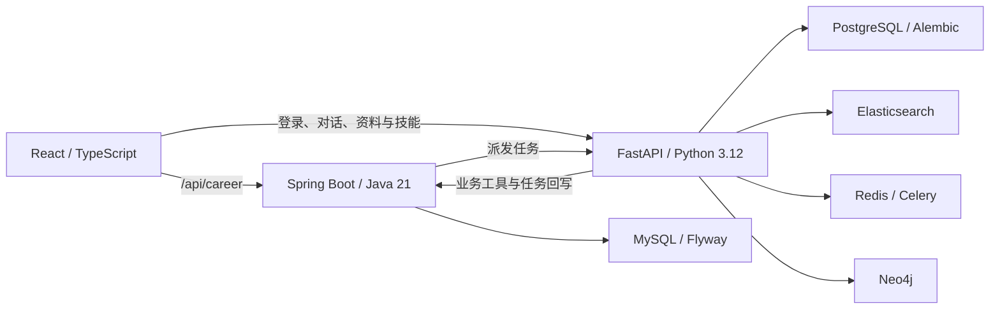

# Search Agent

Search Agent 是面向研究生实习与校招的求职工作台。它以目标岗位 JD 为主线，把个人资料、训练计划、刷题、模拟面试、简历定制和投递进展连在一起。

## 功能

| 功能 | 使用方式 |
| --- | --- |
| 岗位与经历 | 管理目标岗位、公司、招聘来源和备考偏好。简历依据用户确认的经历生成。 |
| 备考中心 | 按岗位生成训练计划、模拟题和复习建议。支持题库、错题、成组练习和进度续做。编程与 SQL 练习可接入隔离判题执行器。 |
| 模拟面试 | 支持文字多轮面试、动态追问和逐题复盘。点评在后台执行，复盘可用于同岗位的后续训练。 |
| 简历与投递 | 编辑简历、按岗位保存版本并导出 PDF，管理网申草稿、提交材料和投递阶段历史。Greenhouse 扩展可辅助填表，提交由用户核对并确认。 |
| 资料与 Skill | 上传个人资料用于备考，知识库问答提供检索引用。技能中心支持求职模板，以及 ZIP 或公开 GitHub 仓库固定提交的技能包安装、更新、回退与卸载。 |
| 任务与提醒 | 查看任务进度和运行统计，暂停、继续或取消备考任务。可关联岗位设置面试、复习和投递截止提醒。 |

[功能入口、判题执行器、Greenhouse 扩展与 Skill 包格式](docs/career-agent-release.md)

## 架构



- **Java 业务服务**负责鉴权、岗位和材料、任务调度及业务状态。MySQL 短事务原子认领任务，通过租约、执行代次和幂等键处理过期回写与重复请求。
- **Python Agent**负责模型调用、Function Calling、上下文预算、Skill 加载和资料检索。训练任务持久化题目目录与计划草稿，可从检查点恢复。知识库使用父子分块、向量与 BM25 混合召回，并支持可选重排。
- **React 前端**提供求职工作台、流式对话、文档预览和任务状态。页面与 Agent 共用 Java 业务接口及权限规则。

## 本地启动

准备 Docker Compose、JDK 21、Python 3.12、uv 和 Node.js 22 或更新的 LTS 版本。以下命令以 PowerShell 为例。

### 1. 配置并启动存储

从仓库根目录创建本地配置。已有配置可继续使用。

```powershell
if (!(Test-Path .env)) { Copy-Item .env.example .env }
if (!(Test-Path api/.env)) { Copy-Item api/.env.example api/.env }
```

| 配置 | 设置位置 |
| --- | --- |
| `JWT_SECRET` | `api/.env` 与 Java 启动终端使用相同的随机值，默认 HS256 要求至少 32 字节。 |
| `CAREER_AGENT_INTERNAL_TOKEN` | `api/.env` 与 Java 启动终端使用同一个随机令牌。 |
| `CAREER_MYSQL_PASSWORD` | 根目录 `.env` 和 Java 启动终端使用相同的 MySQL 密码。若使用已有数据卷，沿用该卷初始化时的密码。 |
| `FERNET_KEY` | 填入 `api/.env`。安装 Python 依赖后，可在 `api/` 运行 `uv run --locked python -c "from cryptography.fernet import Fernet; print(Fernet.generate_key().decode())"` 生成。使用已有 PostgreSQL 数据时沿用原密钥。 |

如果改了根目录 `.env` 中的 PostgreSQL 或 Neo4j 登录配置，也要同步 `api/.env`。

```powershell
docker compose up -d --build --wait postgres elasticsearch neo4j redis
docker compose -f compose.career.yml up -d --wait
```

### 2. 启动 Python Agent

在单独的终端从仓库根目录执行。安装依赖后确认 `api/.env` 已配置有效的 Fernet 密钥。

```powershell
Set-Location api
uv sync --locked --python 3.12
uv run --locked alembic upgrade head
uv run --locked uvicorn app.main:app --host 127.0.0.1 --port 8000
```

文档上传后的索引构建需要 Celery Worker。在另一个终端进入 `api/` 后运行。

```powershell
uv run --locked celery -A app.celery_app.celery_app worker -l info -Q default,parse,memory,beat,research --pool=threads --concurrency=4
```

### 3. 启动 Java 后端和前端

从仓库根目录另开终端启动 Java。Flyway 会在启动时迁移 MySQL。

```powershell
$env:JWT_SECRET = Read-Host 'api/.env 中的 JWT_SECRET' -MaskInput
$env:CAREER_AGENT_INTERNAL_TOKEN = Read-Host 'api/.env 中的内部令牌' -MaskInput
$env:CAREER_MYSQL_PASSWORD = Read-Host '本地 MySQL career 用户密码' -MaskInput
Set-Location backend
.\mvnw.cmd spring-boot:run
```

从仓库根目录另开终端启动前端。

```powershell
Set-Location web
npm ci
npm run dev
```

打开 [本地工作台](http://localhost:5173)，注册或登录后进入「设置 → 模型配置」。配置支持工具调用的默认对话模型。需要知识库索引和检索时，再配置输出维度与 `EMBEDDING_DIMS` 一致的 Embedding 模型。

| 检查 | 地址 |
| --- | --- |
| Java 与 Agent 联通 | [`/api/career/health`](http://localhost:5173/api/career/health) |
| Python 存储连接 | [`/api/health`](http://localhost:5173/api/health) |

## 容器部署

根目录 `.env` 需要配置 `JWT_SECRET`、`FERNET_KEY`、`CAREER_MYSQL_PASSWORD` 和 `CAREER_AGENT_INTERNAL_TOKEN`。在 `web/nginx.conf` 设置部署域名与证书文件名，并将证书放入 `web/certs/`。

```powershell
docker compose -f docker-compose.yml -f docker-compose.prod.yml up -d --build --wait
```

## 评测与验证

| 评测 | 实测结果 |
| --- | --- |
| RAG 检索 | 在 48 篇中文技术短文档、40 条标注查询上，混合检索 Recall@5 为 **90.00%**，较 BM25 提高 **5.00 个百分点**。Hit@5 为 **92.50%**，MRR@5 为 **0.8562**。评测使用本地 BGE-small-zh-v1.5 向量，关闭 Rerank。 |
| 岗位上下文 | 在 72 条合成对话、144 条约束标注上，约束召回率从固定 40 条消息基线的 **83.33%** 提升至 **98.61%**，平均历史片段 Token 减少 **50.89%**。 |
| Java 任务调度 | 隔离 MySQL 上的 36 组并发负载中，540 个任务无重复认领，540 次重复请求均返回原任务。24 次租约到期接管全部成功，并拒绝了旧执行者的回写。 |
| 训练断点恢复 | 两处故障注入中，题目目录保存后恢复需 **1 次**模型调用，计划草稿保存后恢复需 **0 次**，最终各保留 **1 份计划**。 |

[数据集、指标口径与复跑命令](docs/career-agent-evaluation.md) · [训练恢复实测](docs/career-agent-training-checkpoints.md)

开发验证包括 `api/` 下的 `uv run --locked ruff check .`、`backend/` 下使用独立 MySQL 测试库运行的 `.\mvnw.cmd verify`，以及 `web/` 下的 `npx tsc --noEmit` 与 `npm run build`。

## 目录

| 路径 | 内容 |
| --- | --- |
| [backend/](backend/) | Spring Boot 业务服务、Flyway 迁移和集成测试 |
| [api/](api/) | FastAPI、Agent、知识库、Celery 和 Alembic 迁移 |
| [api/eval/](api/eval/) | 标注测试集与评测脚本 |
| [web/](web/) | React 求职工作台 |
| [tools/](tools/) | 判题执行器与 Greenhouse 浏览器扩展 |
| [docs/](docs/) | 架构、功能指南与评测记录 |
