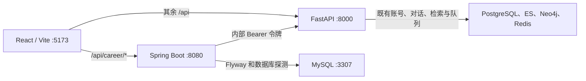

# 第一天 · 本地启动与联通

本地在宿主机运行 React、Java 和 Python。Comet 依赖的 PostgreSQL、Elasticsearch、Neo4j、Redis 沿用原 Compose，求职 MySQL 由独立 Compose 管理。两个 Compose 项目各自保留数据卷。Java 启动时由 Flyway 依次执行求职库迁移。`career_profile` 使用 Comet 用户 UUID 作为主键。

## 运行环境

| 组件 | 版本和启动入口 |
| --- | --- |
| Java | JDK 21，Spring Boot 3.5.16，MyBatis-Plus Boot 3 Starter 3.5.18 |
| Maven | 项目内 Maven Wrapper 3.3.4，固定下载 Maven 3.9.16 |
| MySQL | MySQL 8.4.13，宿主机端口 3307 |
| Python | Python 3.12，`uv sync --locked` 按原 `api/uv.lock` 安装 |
| React | Node.js 22 或更新的 LTS 版本，`npm ci` 按原 `web/package-lock.json` 安装 |

兼容性依据见 [Spring Boot 3.5](https://docs.spring.io/spring-boot/3.5/system-requirements.html)、[MyBatis-Plus](https://baomidou.com/getting-started/install/)、[Apache Maven Wrapper](https://maven.apache.org/tools/wrapper/maven-wrapper-plugin/usage.html) 和 [MySQL Community Server 8.4](https://dev.mysql.com/downloads/mysql/8.4.html?os=3)。

## 本地启动

以下命令在 PowerShell 7 中运行。先启动 Docker Desktop，设置 JDK 21 的 `JAVA_HOME`，并确认 `uv` 和 `npm` 可用。首次启动按需从模板创建本地配置，已有配置继续使用。

`JAVA_HOME` 指向含有 `bin/java.exe` 和 `bin/javac.exe` 的 JDK 目录。可运行 `& "$env:JAVA_HOME/bin/java.exe" -version` 确认版本。如果终端找不到 `docker`，将实际安装目录下的 `resources/bin` 加到该终端的 `PATH`，再运行 `docker version` 检查是否能连到引擎。

若继续使用本次验收的工作区，可以在仓库根目录运行以下命令，让当前终端使用测试时准备的工具。每个新终端按需执行一次。

```powershell
$dockerBin = Join-Path $env:LOCALAPPDATA 'Programs/DockerDesktop/resources/bin'
if (Test-Path "$dockerBin/docker.exe") { $env:Path = "$dockerBin;$env:Path" }
$jdk = Get-ChildItem tmp/toolchains/zulu-jdk -Directory -ErrorAction SilentlyContinue | Select-Object -First 1
if ($jdk) { $env:JAVA_HOME = $jdk.FullName }
$uvExe = Get-ChildItem tmp/toolchains/uv-pypi -Recurse -Filter uv.exe -ErrorAction SilentlyContinue | Select-Object -First 1
if ($uvExe) {
    $env:Path = "$($uvExe.DirectoryName);$env:Path"
    $env:UV_PYTHON_INSTALL_DIR = "$PWD/tmp/toolchains/python"
    $env:UV_CACHE_DIR = "$PWD/tmp/uv-cache"
}
```

| 配置 | 填写位置 | 用途 |
| --- | --- | --- |
| `CAREER_MYSQL_PASSWORD` | Java 启动终端 | Compose 首次创建 MySQL 的 `career` 账号，Java 用相同密码连接 |
| `CAREER_AGENT_INTERNAL_TOKEN` | Java 启动终端和 `api/.env` | Java 调用 Python 时的共享令牌，两处填写相同值 |
| `JWT_SECRET` | Java 启动终端和 `api/.env` | Comet 登录令牌签名和 Java 验签，两处填写同一个值。HS256 需要至少 32 字节 |
| `JWT_ALGORITHM` | Java 启动终端和 `api/.env` | 两处算法一致，默认为 HS256 |
| `FERNET_KEY` | `api/.env` | 加解密 PostgreSQL 中已有或新录入的模型密钥，使用已有库时保留原值 |
| 模型名、Base URL、API Key | 浏览器的模型配置 | Comet 调用你的模型服务 |

在仓库根目录启动存储，并保留当前终端运行 Java。

```powershell
if (!(Test-Path .env)) { Copy-Item .env.example .env }
$env:CAREER_MYSQL_PASSWORD = Read-Host '本地 MySQL career 用户密码' -MaskInput
$env:JWT_SECRET = Read-Host 'api/.env 中的 JWT_SECRET' -MaskInput
$env:CAREER_AGENT_INTERNAL_TOKEN = [Convert]::ToHexString([Security.Cryptography.RandomNumberGenerator]::GetBytes(32))
$env:CAREER_AGENT_INTERNAL_TOKEN # 在本地复制此值，填入下面的 api/.env
docker compose build elasticsearch
docker compose up -d --wait postgres elasticsearch neo4j redis
docker compose -f compose.career.yml up -d --wait
Set-Location backend
.\mvnw.cmd spring-boot:run
```

MySQL 复用现有数据卷时，继续使用该卷初始化时为 `career` 设置的密码。已有可用的 MySQL 8.4 实例也可以使用。为 Java 设置 `CAREER_MYSQL_URL`、`CAREER_MYSQL_USER` 和 `CAREER_MYSQL_PASSWORD`，并确保账号有权在专用库中执行迁移。

在另一个终端从仓库根目录进入 `api`。在本地 `api/.env` 填入与 Java 相同的 `CAREER_AGENT_INTERNAL_TOKEN`，并按 [Comet 运行说明](../README.md#第-3-步配置并启动后端) 设置本地 JWT 与 Fernet 密钥。Python 用 Alembic 更新自己的 PostgreSQL 表。

```powershell
Set-Location api
if (!(Test-Path .env)) { Copy-Item .env.example .env }
uv sync --locked --python 3.12
# 编辑 .env 后启动
uv run --locked alembic upgrade head
uv run --locked uvicorn app.main:app --host 127.0.0.1 --port 8000
```

在第三个终端启动 React。

```powershell
Set-Location web
npm ci
npm run dev
```

打开 [本地前端](http://localhost:5173)。通过前端代理访问 [Java 就绪检查](http://localhost:5173/api/career/health) 应返回 HTTP 200，`db` 和 `agent` 状态均为 `UP`。通过同一代理访问 [Comet hello 接口](http://localhost:5173/api/hello) 可确认原 Python 路由可达。随后打开 [Comet 存储检查](http://localhost:5173/api/health)，确认 `data.healthy` 为 `true`。

如需确认迁移版本，在设置了 `CAREER_MYSQL_PASSWORD` 的终端回到仓库根目录，执行下列命令，并在提示后输入数据库密码。

```powershell
docker compose -f compose.career.yml exec mysql mysql -u career -p search_agent -e 'SELECT version, success FROM flyway_schema_history; SHOW TABLES;'
```

## 服务契约



| 路径 | 调用方 | 返回 |
| --- | --- | --- |
| `GET /api/career/health` | 前端或本地运维 | Java 检查 MySQL 连接和 Agent HTTP 响应。两者就绪为 200，依赖异常为 503，响应包含 `status` 和组件状态 |
| `GET /internal/v1/health` | Java，携带 `Authorization: Bearer <内部令牌>` | 200 和 `{"status":"UP"}` 表示 Python 可接收请求。令牌缺失或错误返回 401，Python 未配置令牌返回 503。错误沿用 Comet 的 `code/message/data` |
| `GET /api/health` | Comet | 检查 PostgreSQL、Elasticsearch、Neo4j 和 Redis |

Vite 将 `/api/career` 路由至 Java，其余 `/api` 路由仍到 Python。`/internal/v1` 只供服务间访问。Java 连接和读取分别限制为 2 秒与 3 秒，认证失败或响应不符合契约时将 Agent 标记为 `DOWN`。

Java 验证 Comet 访问令牌的签名、有效期及 `type=access`，从 `sub` 取得用户 UUID。任务派发携带 Java 确定的用户和执行租约，写入结果时校验租约。完整流程见[岗位训练与申请材料](career-agent-day-4-5-workflow.md)。

## 真实模型验收

在 Comet 注册测试账号，通过 **设置 → 模型配置** 保存支持 OpenAI 兼容接口和原生工具调用的对话模型。填写供应商提供的模型名、Base URL 和 API Key，通过连接测试后设为默认，并启用 `function_call`。模型密钥按 Comet 的既有加密方式保存在 PostgreSQL。时间工具验收只需对话模型。体验 Comet 的知识库检索时，另按上游运行说明配置与 `EMBEDDING_DIMS` 一致的 Embedding 模型。

在 `api` 目录执行下列命令，将 `demo_user` 换成自己的 Comet 用户名。看到 `tool_result: datetime success` 和模型给出的时间回答后，才计为真实工具调用通过。

```powershell
uv run --locked python -m scripts.check_model_tool_call demo_user
```

## 代码阅读顺序

1. [Vite 代理](../web/vite.config.ts) 按路径把浏览器请求分给两个后端。先看 `/api/career/health`，再对照 `/api/hello`。
2. [Java 配置](../backend/src/main/resources/application.yml) 接入数据源和 Actuator。[Flyway SQL](../backend/src/main/resources/db/migration/V1__create_career_profile.sql) 随应用启动执行，迁移版本写入 MySQL 的 `flyway_schema_history`。
3. [Java 探测](../backend/src/main/java/com/searchagent/career/integration/AgentHealthIndicator.java) 通过 HTTP 调用 [Python 内部接口](../api/app/controllers/career_internal_controller.py)。Python 验证服务令牌后返回状态，Java 将它和数据库状态一起交给前端。
4. [模型验证脚本](../api/scripts/check_model_tool_call.py) 从 Comet 读取账号已配置的默认模型，走原有 Agent 编排执行 `datetime`，再把结果交回模型。

## 11 月 6 日验收记录

| 检查 | 实测结果 |
| --- | --- |
| Java 构建 | Windows 下用 JDK 21 和 Maven Wrapper 执行 `verify` 通过 |
| 数据库和迁移 | MySQL 8.4.13 容器健康，`flyway_schema_history` 的 V1 记录成功，重启后仍只有一条 V1 记录，`career_profile` 可查询 |
| 三端联通 | Vite 代理的 `/api/hello` 和 `/api/career/health` 均返回 200，Java 的 `db` 和 `agent` 均为 `UP`。Comet 的四项存储检查均通过 |
| 失败路径 | Python 拒绝缺失或错误令牌的请求。停止 Python 后，Java 健康检查返回 503，`agent=DOWN` 且 `db=UP` |
| Python 检查 | `uv sync --locked` 和 Ruff 通过，内部健康接口 3 项测试通过，模型验证脚本可加载 |
| 前端检查 | TypeScript 类型检查和 Vite 构建通过，构建有包体积和混合导入提示 |
| 真实模型工具调用 | 待使用者在 Comet 配置模型后按本页步骤验收 |
