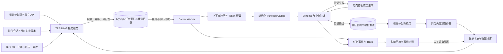
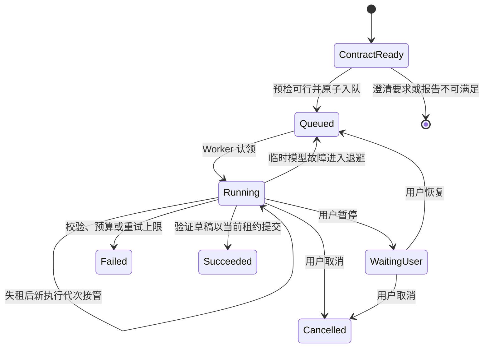
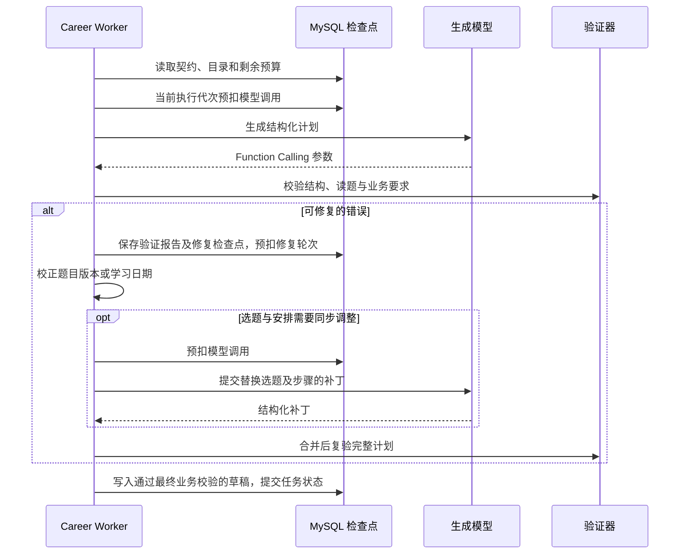

# TRAINING Harness V2 技术实现报告

## 改造前后

基线为 GitHub `main` 的 `9e730be`。V1 的原生 Python Worker 已按岗位查题、冻结题目目录和上下文、检查题目 ID、版本、重复项和指定题，并在无效输出后整份重生成一次。MySQL 队列已经有幂等提交、续租、执行代次、检查点、重试退避和任务事件。V1 根据近期作答识别薄弱知识点。截止日期、题量、复习顺序和岗位技能覆盖仍由模型理解，恢复后每轮仍能用完整的新生成机会。

V2 将这些完成条件写入任务契约，在入队前验证可行性，保存同一时点的候选题及完成状态。Workflow 使用结构化 Function Calling，独立校验 Schema 和业务规则，成功草稿保留原 `steps` 和 `questions` 字段，并新增结构化 `schedule`。页面按实际安排顺序展示题目。抛出业务错误时，用户可以在任务事件中查看错误位置、原因和修复方式。

公开设计参考是 Claude Code 的上下文收集、执行、验证循环，以及 OpenAI 的可验证反馈实践。这里将验证条件落实到求职任务的数据库记录、版本化题目和可回放结果上。[Claude Code 文档](https://code.claude.com/docs/en/how-claude-code-works) · [OpenAI Harness Engineering](https://openai.com/index/harness-engineering/)

## 架构与执行







### 契约与作用域

- 系统策略优先执行认证、岗位归属、题库范围、只读训练工具及预算。API `requirements` 的显式字段覆盖自然语言解析和确认的会话约束。题量、期限、有序优先技能、指定题版本和排除已做题属于硬约束。后端从岗位技能字段和带要求表述的 JD 段落推导的已识别技能也需要覆盖。用户的其他求职偏好、无法可靠转换的自然语言和选题反馈作为软偏好。
- 聊天只从认证用户、当前会话和对应岗位加载确认过的约束。自然语言仅识别明确表达的精确题量、简明技能清单、复习顺序、常见日期及已做题规则。原文保留在任务快照。相对日期用浏览器提供的 IANA 时区和提交时点解析。无时区的相对日期、冲突日期和未识别的截止写法要求澄清。对「周五前」采用包含周五的日历截止；需要指定具体某天时可提交 `YYYY-MM-DD`。独立任务接口读取本次 `requirements`，支持相同用户和岗位下的独立请求幂等。
- 可行性先处理指定版本和已做题，再检查需要覆盖的技能，以及在题量以内是否存在可用组合。可行集合优先进入最多 30 道题的候选快照。已做按精确版本冻结，客观题使用分数和作答记录，开放题使用已完成的本岗位点评或模拟面试记录。岗位题库的公开历史版本可作为用户显式指定题；私有模拟题校验所属用户、岗位和已完成的批次。

### 恢复、验证与修复

- 队列继续解决并发、取消、退避和失租。V2 在每次模型调用或修复前提交计数，租约与执行代次写入条件阻止旧 Worker 覆盖。单次 Worker 执行仍有 85 秒上限，V2 从第一次执行开始累计 300 秒墙钟时限，涵盖退避、暂停和接管间隔。每个任务累计最多 3 次模型调用、2 轮修复。模型输入取契约的 12,000 Token 上限与模型实际输入预算中的较小值。供应商 SDK 内部重试已关闭，临时错误交给队列。上下文超限时优先压缩资料和题干，保留用来完成业务校验的字段。训练任务执行外部工具调用的额度为零。
- Pydantic 校验参数及工具调用形状。业务校验比对冻结的题目与版本、重复、题量、指定题、已做题、技能覆盖、日期、排程顺序、步骤引用和个人经历 ID。个人经历的自由文本归因属于语义风险，结构校验覆盖明示的经历引用。
- 错误版本和日期优先用确定性修复；选题与排程互相依赖时用只包含这两组字段的补丁工具，保留岗位分析和经历引用。无合法结构、引用非确认经历或错误位置无进展时允许整份重生成。每次合并后复验完整结果；通过后，草稿保存入口重新比对权威快照并用原检查点持久化。恢复已验证草稿可以省去模型调用。
- 语义质量评估复用研究工作流的同模型或跨模型 Verifier，在离线 `--semantic` 下评价业务已通过的结果。运行指标与选题策略切换由工程维护者审核；任务保存和权限校验由确定性程序完成。

### 技能状态与评测记录

- V2 学习策略保持每道题最后一次客观作答作为独立证据，对已有 30 天窗口应用 14 天半衰期。非当前版本的证据权重减半。掌握度为 `(1 + 加权正确数) / (2 + 总权重)`。总权重低于 1.5 或有效题数少于两道进入探索。样本足够、有至少两道错题且估计值低于 0.45 时进入补弱，其余进入巩固。用于推荐的估计分数以及证据数量、时间、引用随任务冻结。没有可用样本时保留岗位技能覆盖并推荐探索。
- 每轮验证记录任务和代次、契约与策略版本、模型配置编号和修订时间、错误码和位置、修复方式、调用计数、供应商实际返回的 Token 和延迟。通过业务检查后的草稿保留在任务中。失败回放快照保留校验需要的选题、顺序和日期，去掉模型分析、步骤标题、目录外题目原始标识及个人经历标识。诊断详情仅对任务所有者和有数据库访问权的本地运维开放，保留 30 天，每次清理最多 200 条载荷，原事件和任务状态继续保留。
- 新任务默认使用 `CAREER_TRAINING_HARNESS=v2`、`CAREER_TRAINING_REPAIR=local-v1`，学习策略默认 `CAREER_TRAINING_LEARNING=objective-practice-v1`。可切换 `regenerate-v1` 或 `objective-practice-v2` 比较，也可用 `CAREER_TRAINING_HARNESS=v1` 回退新任务。已有任务以保存的版本为准，缺少契约的历史任务走 V1。真正更新应用版本前先执行 MySQL V20，迁移只增加可空字段和归档索引。

## 评测

从 `api/` 运行。Windows 本次验收使用 Python 3.12.13、MySQL 8.4.13 和现有锁定依赖，模拟模型固定输出，生产路径温度设为 0.2。

```powershell
uv run --locked python -m unittest discover -s tests
uv run --locked python -m eval.career_training_harness_eval
uv run --locked python -m eval.career_workflow_eval
uv run --locked python -m eval.harness_v2_eval
uv run --locked python -m eval.harness_v2_replay --fixture <fixture.json>
uv run --locked python -m eval.harness_v2_replay --task <task-uuid> --owner <owner-uuid>
uv run --locked python -m eval.career_attempt_replay --user <owner-uuid> --job <job-uuid>
uv run --locked python -m eval.harness_v2_eval --live-user <authorized-test-user-uuid>
uv run --locked python -m eval.harness_v2_eval --live-user <authorized-test-user-uuid> --semantic
```

1. **确定性与数据库验证。** 单元测试覆盖相对日期、数字、冲突及不确定输入、候选可行性、错误分类、预算和练习状态。隔离 MySQL 验证空库 V1–V20、已有 V19 的可空升级、历史任务保留、实际提交幂等、失租接管、取消和诊断重放。队列负载脚本使用 16 次并发提交、8 个独立任务、12 个认领请求，并核验同时认领最多 4 个任务。
2. **模拟模型。** 五组各用 19 个固定案例。A 使用现有 V1 生成、校验、重试和检查点。B 增加契约提示和入队可行性。C 增加结构化业务验证和持久预算，并继续用整份重生成。D 启用定向修复。E 启用 V2 学习状态。A/B 的日期和顺序由同一套离线业务规则读取夹具中的 ISO 日期和题目顺序验证。
3. **真实历史。** 实现了按岗位和时间切分作答的只读回放。当前评测未使用真实用户作答记录。
4. **真实模型。** 需要选择明确授权的测试账号及模型服务。当前实测使用了模型替身，真实提供商的 Token、语义质量和端到端延迟尚无数据。

原始 V1 的候选排序基线在 8 个合成用例里保留 25/25 个必备技能和 8/8 道指定题；启用原 V1 练习反馈后，薄弱技能下未做题进入前四名的用例从 2/8 增至 8/8。此前文档中的单次供应商功能验证与本次五组对照使用不同环境和任务，不合并统计。

`9e730be` 基线测试执行 65 项，跳过 8 项。原工作流的 4 个模型替身案例全部成功，首次及重试共 6 次模型调用，4 次工具提交通过，候选目录检查点恢复 2/2。原脚本用文本中是否提到截止日衡量截止要求，结果为 2/2。

| 19 个模型替身案例 | A · V1 | B · 契约 | C · 验证和运行控制 | D · 定向修复 | E · V2 学习 |
| --- | ---: | ---: | ---: | ---: | ---: |
| 最终任务成功 | 11/19 | 15/19 | 17/19 | 17/19 | 17/19 |
| 硬约束遵守 | 11/18 | 15/17 | 17/17 | 17/17 | 17/17 |
| 首次通过 | 4/18 | 7/17 | 7/17 | 7/17 | 7/17 |
| 修复成功 | 7/14 | 8/10 | 10/10 | 10/10 | 10/10 |
| 模型调用总数 | 26 | 26 | 27 | 24 | 24 |
| 平均模型调用 | 1.368 | 1.368 | 1.421 | 1.263 | 1.263 |
| 供应商 Token 计量覆盖 | 0/26 | 0/26 | 0/27 | 0/24 | 0/24 |
| 本地 P95 耗时（毫秒） | 9.215 | 2.455 | 9.852 | 8.352 | 11.196 |
| 必备技能覆盖 | 35/39 | 33/39 | 34/39 | 34/39 | 34/39 |
| 薄弱技能下未做题覆盖 | 1/1 | 1/1 | 1/1 | 1/1 | 1/1 |
| 指定题保留 | 2/2 | 2/2 | 2/2 | 2/2 | 2/2 |
| 检查点恢复 | 2/2 | 2/2 | 2/2 | 2/2 | 2/2 |
| 初稿合法题引用保留 | 20/21 | 12/13 | 11/13 | 11/13 | 11/13 |
| 初稿分析保留 | 7/13 | 2/9 | 0/9 | 9/9 | 9/9 |

A 组保存的计划中出现题量或日期缺失、复习顺序错误、技能缺失、超期及重复安排已做题。B 组在接收契约提示的夹具上改善了题量与顺序，仍保存了技能缺失和超期结果。C–E 两个预期终止案例分别是题库缺少 Spring 题和模型输入预算只有 500 Token。覆盖指标按所有场景计算，含拒绝保存的任务。定向修复比整份重生成减少 3 次替身模型调用，合格的初稿分析保留 9/9，合法题引用保留率相同。分析保留数字受替身重生成时改写分析的行为设定影响。D/E 的聚合结果一致，学习策略的可区分行为由冷启动、旧版本证据和近期作答变化的确定性用例覆盖。平均 Token 用量和语义评分缺失。

本地验证通过 78 项 Python 测试中的 68 项，其余 10 项由所需环境门控。另在隔离 MySQL 上运行了其中 2 项集成测试，验证了取消后旧代次无法写入、修复阶段接管后沿用累计预算且全程只调用一次替身模型，以及脱敏诊断回放。Ruff、前端 TypeScript 和生产构建通过。生产构建保留了既有的 Vite 大分块和混合导入提示。

指标分母和解释见下表。相互依赖的模块按增量组比较。

| 指标 | 分母或方法 |
| --- | --- |
| 最终任务成功率 | 保存且通过完整业务校验的任务 / 所有场景，包含预检拒绝和预算终止场景 |
| 硬约束遵守率 | 通过完整业务校验的已保存计划 / 已保存计划 |
| 首次通过率 | 首次提交通过完整业务校验的任务 / 发生模型调用的任务。真实模型模式 A/B 的首轮检查以现有 V1 事件为准 |
| 修复成功率 | 首次失败后最终通过的任务 / 首次有输出但未通过的任务，含基线没有主动修复的错误 |
| 平均模型调用数与 Token | 调用总数 / 所有场景；Token 为有实际 usage 的调用平均值，同时报告计量覆盖 |
| P95 延迟 | 取排序后的第 `ceil(0.95 × n)` 个耗时，模拟数据只反映本地评测路径 |
| 必备和薄弱技能覆盖 | 最终计划的覆盖技能数 / 所有场景标注技能数；薄弱覆盖要求选到该技能下尚未练习的题目 |
| 指定题保留率 | 最终计划保留的精确指定题 / 所有指定题引用 |
| 检查点恢复率 | 模拟中断后校验成功的任务 / 触发中断的任务；MySQL 另测真实租约代次 |
| 分析及选题保留 | 有可解析初稿且首次校验失败、最终有保存结果的任务中，分析文本保留数，以及初稿合法题引用的交集 |

## 修改文件与验证

| 文件 | 变更与兼容性 | 对应验证 |
| --- | --- | --- |
| `api/app/services/career_training_contract.py` | 构造版本化、作用域明确的契约，解析可确证输入并找出可行候选集合 | 契约与可行性单测 |
| `api/app/services/career_training_verifier.py` | 复用 Pydantic 并新增业务校验、确定性修复和脱敏回放载荷，输出兼容文本步骤 | 验证、修复、故障注入 |
| `api/app/services/career_training_runtime.py` | 记录统一的累计预算、验证、修复和恢复状态 | 模拟中断与 MySQL 接管 |
| `api/app/services/career_learning_state.py` | 按最新作答、版本、时效和样本置信度计算状态 | 冷启动、多次作答、版本和近期变化 |
| `api/app/services/career_training_harness.py` | 兼容原 V1 排序输入，加入 V2 推荐理由与巩固候选 | 原 V1 基线及 D/E 组 |
| `api/app/controllers/career_task_controller.py` | 添加可选结构化参数，入队前冻结契约及初始题库 | 提交、作用域、幂等回归 |
| `api/app/services/career_training.py` | 复用岗位、经历、练习和模拟题查询，冻结题目与完成版本 | MySQL 提交与原练习进度回归 |
| `api/app/services/career_practice.py` | 为显式技能和题目扩充候选匹配，新增学习时间及版本证据 | 原题库、V2 选题和学习对照 |
| `api/app/services/career_question_catalog.py` | 复用别名词表处理准确技能表达 | 契约解析、候选排序基线 |
| `api/app/services/career_task_service.py` | 在原 TRAINING Workflow 中执行验证、修复及上下文预算，保留 V1 函数调用路径 | 工作流回归、A–E 组 |
| `api/app/services/career_context.py` | 由 V2 执行分开装配契约与其他输入 | 上下文及预算回归 |
| `api/app/services/career_worker.py` | 接入状态恢复、保存复验和结果归档，复用队列状态和 Trace | 隔离 MySQL 的生成、接管和取消 |
| `api/app/services/career_queue.py` | 同事务写入目录，复用现有租约条件保护运行状态和事件 | 幂等、并发、租约和退出恢复 |
| `api/app/services/career_chat_tools.py` | 岗位聊天提交当前请求、时区与会话范围 | 聊天任务回归、混合约束输入 |
| `api/app/services/chat_service.py` | 使用当前认证会话的上下文版本 | 聊天任务回归 |
| `api/app/schemas/chat_schema.py` | 可选 IANA 时区字段 | 原聊天请求兼容及混合约束输入 |
| `api/app/core/llm/chat_model.py` | 支持 V2 单次模型调用禁用 SDK 重试 | 模型配置及任务运行回归 |
| `api/app/core/agent/loop/verifier/llm_verifier.py` | 复用语义验证模型和评分解析，按备考 rubric 切换提示 | 原 Verifier 回归、离线语义入口 |
| `api/app/core/agent/loop/verifier/prompts/verify_training.jinja2` | 增加备考相关性、可执行性和练习反馈评分提示 | 模板渲染回归 |
| `api/app/db/career.py` | 启动验收增加 V20 | 隔离 MySQL 迁移 |
| `api/scripts/migrate_career_mysql.py` | 在原迁移校验链中应用 V20 | 空库及已有 V19 |
| `backend/src/main/resources/db/migration/V20__career_training_harness.sql` | 新增可空执行状态、诊断详情和索引 | V19 历史行保留，V20 归档回放 |
| `api/app/config.py` | 固定支持的策略名称和新任务默认值 | 旧任务及策略回退组 |
| `.env.example`、`api/.env.example`、`docker-compose.prod.yml` | 本地和 Compose 共用策略配置，API 和 Worker 使用同一组默认值 | 配置解析与 Compose 静态校验 |
| `api/eval/harness_v2_eval.py` | A–E 组、模拟模型、显式授权的真实模型及语义评测 | 19 案例逐组复跑 |
| `api/eval/harness_v2_replay.py` | 固定输入及近期任务归档重验 | MySQL 回放和离线校验 |
| `api/eval/career_attempt_replay.py` | 用同一选题集合与按时间切分作答比较学习策略 | 合成状态用例、只读历史入口 |
| `api/tests/test_career_training_v2.py` | 契约、学习状态、预算、修复及提交回归 | Python unittest |
| `api/tests/test_career_training_v2_mysql.py` | 隔离 MySQL 检查真实持久化、接管、取消及回放 | 带数据库参数的 unittest |
| `api/tests/test_career_chat_tools.py` | 更新原聊天任务断言以覆盖作用域 | Python unittest |
| `web/src/api/chat.ts` | 从浏览器读取当前时区 | TypeScript、前端构建 |
| `web/src/api/careerWorkflow.ts` | 类型化请求、排程与验证详情 | TypeScript、前端构建 |
| `web/src/pages/TrainingPlanPage.tsx` | 用户可选择题量、日期、优先技能和已做题排除 | TypeScript、前端构建 |
| `web/src/pages/career/TrainingPlanCard.tsx` | 展示排程和技能推荐原因，兼容文本步骤 | TypeScript、前端构建 |
| `web/src/pages/career/TaskDetails.tsx` | 展示验证和修复事件，兼容旧事件 | TypeScript、前端构建 |
| `README.md`、`docs/README.md`、`docs/python-runtime-operations.md` | 架构入口、策略配置和迁移说明 | 文档链接核对 |

## 工程取舍与履历表述

任务契约把承诺固定于提交时，以业务事实验证是否完成。日期、题量和题目版本都能在 Python 中直接检查，语义模型用于核对安排是否实用或贴合岗位。临时故障进入原队列退避，校验错误留在同一份契约内修复，租约接管从已保存阶段继续。局部修复允许保留合法内容，复杂依赖可以整份重生成。学习推荐从版本化作答记录计算，便于识别冷启动与薄弱样本，也便于撤回策略配置。原 Workflow 已提供工具调用、检查点与 Trace，无需引入新的编排框架。

可用的项目表述是「在 FastAPI 求职 Agent 中实现契约驱动的备考 Harness，基于冻结题库对题量、技能、日期和引用执行确定性校验。复用 MySQL 租约与检查点，提供跨 Worker 累计预算、字段级修复、版本化练习反馈和脱敏失败回放」。实验数字应标注为模型替身结果。真实学习效果、生产流量和模型供应商成本需要独立测量。
